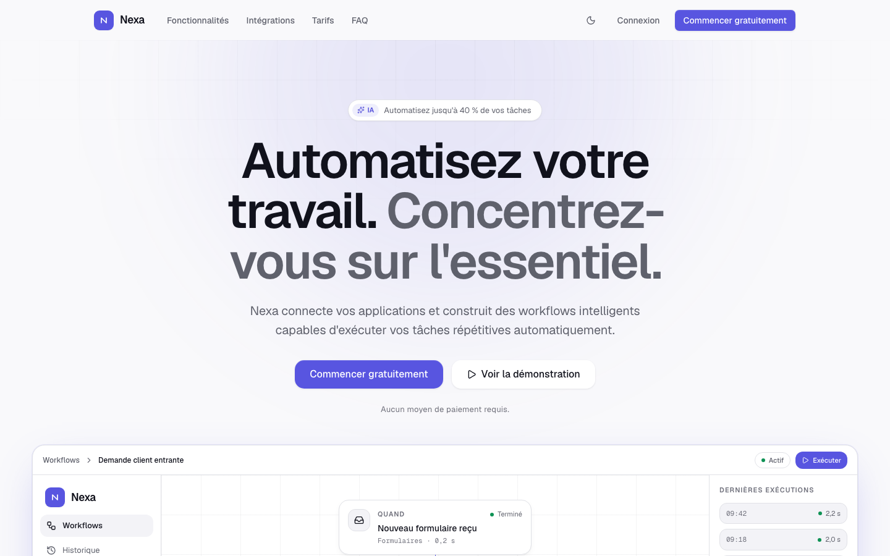
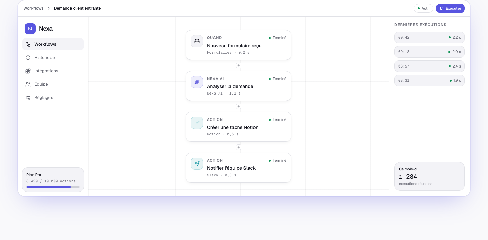
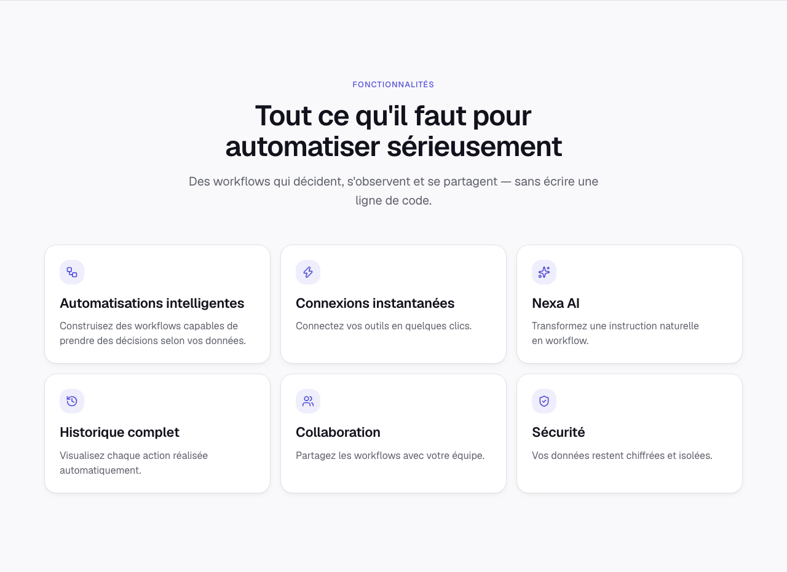
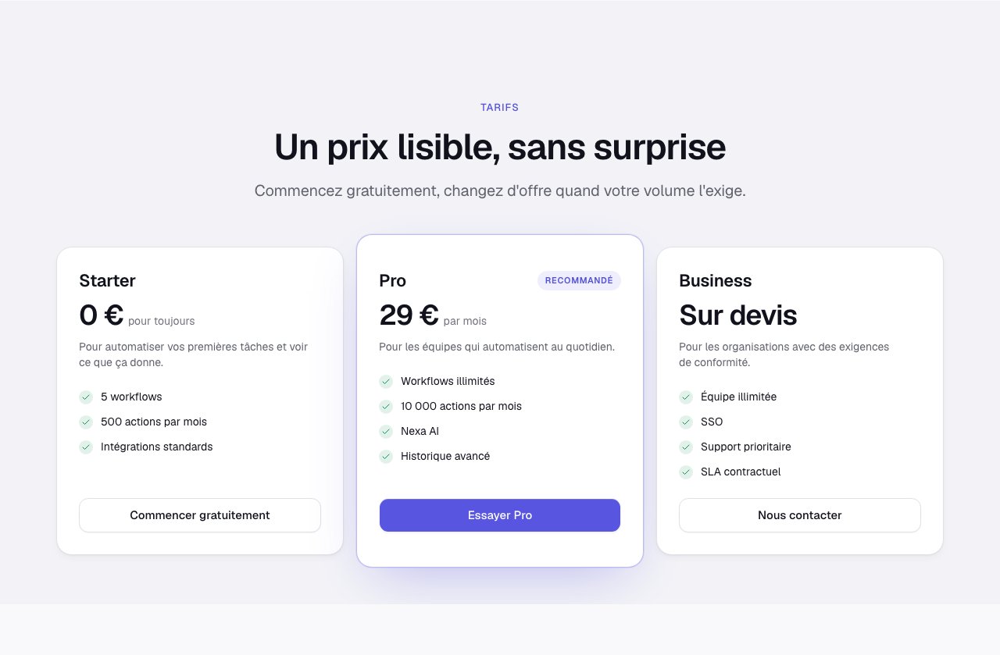
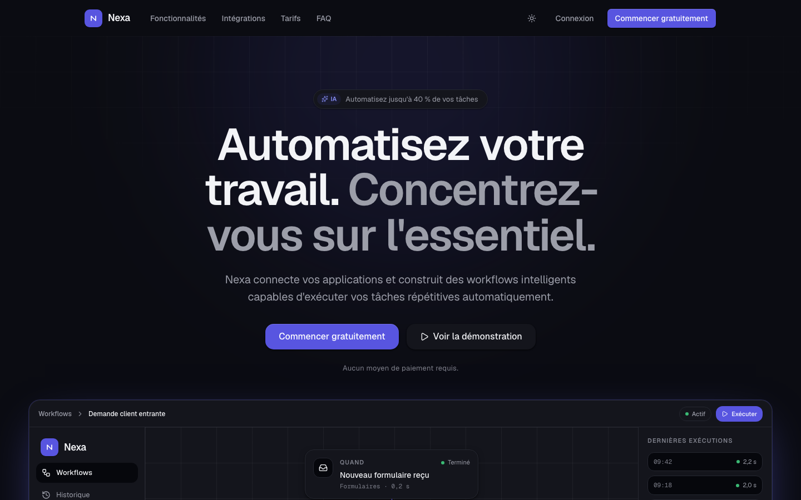
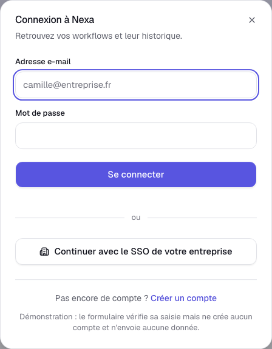
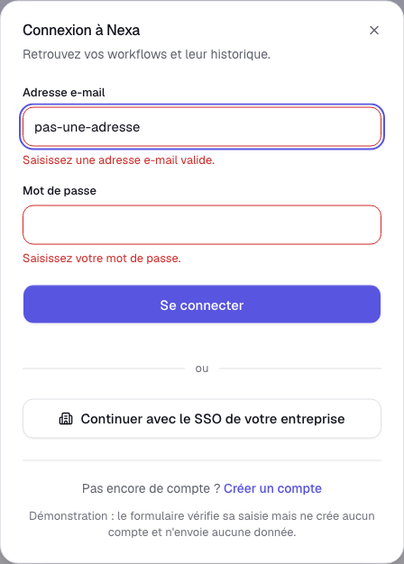
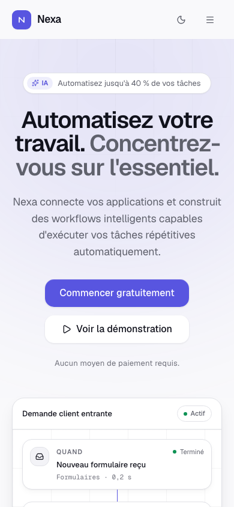

# Nexa — landing page SaaS

Landing page d'un produit d'automatisation fictif, construite comme démonstration
d'intégration frontend : Next.js 16, TypeScript strict, Tailwind CSS v4,
shadcn/ui sur Radix, Motion.

> **Nexa est un projet fictif réalisé à des fins de démonstration et de
> portfolio.** Le produit n'existe pas, aucune donnée n'est collectée, aucun
> paiement n'est possible et les entreprises citées sont inventées.

**Démo en ligne :** _à compléter après déploiement_ ([voir Déploiement](#déploiement))



## Objectifs

Ce dépôt sert de preuve de compétence sur une prestation d'intégration :
transformer une direction artistique en interface réelle, responsive,
accessible et rapide, avec un code lisible et une hiérarchie de composants
claire. Les priorités, dans l'ordre : design, responsive, accessibilité,
performances, qualité du code, animations, SEO.

## Résultats mesurés

Lighthouse, build de production servi en local (`next start`) :

| Catégorie        | Desktop | Mobile |
| ---------------- | ------- | ------ |
| Performance      | 100     | 95     |
| Accessibilité    | 100     | 100    |
| Bonnes pratiques | 100     | 100    |
| SEO              | 100     | 100    |

Desktop : LCP 0,6 s · CLS 0 · TBT 0 ms. Mobile : LCP 2,9 s · CLS 0 · TBT 60 ms.
JavaScript transféré : ~215 kB sur 8 requêtes ; CSS : 10,6 kB.

Aucun débordement horizontal aux huit largeurs testées (375, 390, 430, 768,
1024, 1280, 1440, 1920), dans les deux thèmes.

## Stack

| Domaine    | Choix                             | Pourquoi                                                             |
| ---------- | --------------------------------- | -------------------------------------------------------------------- |
| Framework  | Next.js 16 (App Router), React 19 | Server Components par défaut, très peu de JavaScript client          |
| Langage    | TypeScript strict                 | `noUncheckedIndexedAccess`, `verbatimModuleSyntax`, `noUnusedLocals` |
| Styles     | Tailwind CSS v4                   | Thème défini en CSS (`@theme`), pas de fichier de configuration JS   |
| Composants | shadcn/ui sur Radix               | Uniquement les primitives à comportement, entièrement restylées      |
| Animation  | Motion + `LazyMotion`             | ~6 kB de runtime au lieu de ~34 kB                                   |
| Icônes     | lucide-react                      | Tree-shaking, cohérence de trait                                     |
| Thème      | next-themes                       | Clair/sombre sans flash au chargement                                |
| Tests      | Playwright                        | Les scénarios attendus sont tous des parcours de bout en bout        |

Pas de backend, pas de base de données, pas d'authentification, pas de paiement.

## Ce que la page contient

Header collant · Hero · Aperçu produit · Preuve sociale · Fonctionnalités ·
Intégrations · Comment ça marche · Chiffres · Témoignages · Tarifs · FAQ ·
Appel à l'action final · Pied de page.

Deux modales : la démonstration du workflow et le formulaire de
connexion/inscription.

### Points d'intégration notables

**Palette validée par calcul, pas à l'œil.** Les couleurs sont définies en
OKLCH et chaque paire texte/fond a été vérifiée au ratio WCAG AA dans les deux
thèmes avant d'être retenue. Le violet de marque existe en deux jetons : un
pour les aplats (`--brand`) et un, plus lumineux en sombre, pour le texte
(`--brand-text`), parce qu'un seuil de 3:1 suffit à un aplat mais pas à du
texte de 13 px.

**Maquette produit en deux compositions.** Le constructeur de workflows n'est
pas une image : c'est du DOM. À partir de `lg`, c'est une interface complète
avec barre latérale, barre supérieure, canvas et historique d'exécutions. En
dessous, l'habillage disparaît au profit d'une pile verticale lisible à 375 px.
Les deux partagent le même composant de nœuds, ce qui permet à la modale de
démonstration de rejouer l'exécution étape par étape en pilotant seulement les
statuts.

**Mouvement contenu.** Les survols, dégradés et halos sont en CSS pur ; Motion
ne sert qu'aux entrées, au décalage en cascade et au compteur. `LazyMotion` en
mode `strict` interdit les composants `motion.*` lourds, et
`prefers-reduced-motion` est respecté partout — le compteur affiche
immédiatement sa valeur finale plutôt que de rester figé à zéro.

**Formulaire de connexion sans authentification.** « Connexion » ouvre une
vraie modale avec deux modes, connexion et inscription. La validation est
réelle — format de l'e-mail, longueur du mot de passe, nom requis à
l'inscription — et chaque champ porte `aria-invalid` et pointe vers son
message par `aria-describedby`, le focus allant au premier champ fautif. Mais
rien n'est authentifié : aucune requête n'est émise, `autoComplete` est
désactivé pour qu'aucun gestionnaire de mots de passe ne propose d'enregistrer
un identifiant sur un produit qui n'existe pas, et la modale le dit en toutes
lettres. Un test vérifie qu'aucune requête non-GET ne part.

**Liens sans destination.** Le produit n'existant pas, les entrées de pied de
page sans page correspondante sont du texte, pas des contrôles qui ne mènent
nulle part, et le pied de page le dit. Les boutons de tarifs pointent vers
l'appel à l'action final.

## Captures

| Maquette produit                                 | Fonctionnalités                                   |
| ------------------------------------------------ | ------------------------------------------------- |
|  |  |

| Tarifs                                  | Thème sombre                              |
| --------------------------------------- | ----------------------------------------- |
|  |  |

| Connexion                                      | États d'erreur                               |
| ---------------------------------------------- | -------------------------------------------- |
|  |  |



## Installation

Prérequis : Node.js 20.9 ou plus, pnpm.

```bash
pnpm install
pnpm dev
```

La page est servie sur http://localhost:3000.

Pour exécuter les tests de bout en bout la première fois :

```bash
pnpm exec playwright install chromium
```

## Scripts

| Commande           | Effet                                              |
| ------------------ | -------------------------------------------------- |
| `pnpm dev`         | Serveur de développement                           |
| `pnpm build`       | Build de production                                |
| `pnpm start`       | Sert le build de production                        |
| `pnpm lint`        | ESLint                                             |
| `pnpm typecheck`   | `tsc --noEmit`                                     |
| `pnpm format`      | Prettier avec tri des classes Tailwind             |
| `pnpm test:e2e`    | Playwright (build de production, desktop + mobile) |
| `pnpm screenshots` | Régénère les captures du README                    |

Les captures se prennent sur un serveur déjà lancé :

```bash
pnpm build && pnpm start --port 3100
SITE_URL=http://localhost:3100 pnpm screenshots
```

## Architecture

```
src/
├── app/
│   ├── layout.tsx            métadonnées, polices, thème, provider Motion
│   ├── page.tsx              assemblage des sections
│   ├── globals.css           jetons de design, thèmes clair et sombre
│   ├── opengraph-image.tsx   carte de partage générée au build
│   ├── sitemap.ts
│   └── robots.ts
├── components/
│   ├── layout/               Header, MobileNav, Footer, Container, Section…
│   ├── sections/             une section de la page par fichier
│   ├── product/              maquette produit et modale de démonstration
│   ├── motion/               Reveal, Stagger, variantes partagées
│   ├── theme/                provider et bascule clair/sombre
│   └── ui/                   primitives shadcn restylées, Counter, BrandLogo
├── data/                     tout le contenu rédactionnel, typé
└── lib/                      utilitaire `cn`, configuration du site
tests/e2e/                    cinq scénarios Playwright
scripts/                      génération des captures
```

### Conventions

- Les Server Components sont le défaut. `"use client"` n'apparaît que sur le
  header, le menu mobile, la bascule de thème, l'accordéon, la modale de
  démonstration, le compteur et les enveloppes d'animation.
- Aucune couleur en dur dans un composant : tout passe par un jeton.
- Tout le contenu vit dans `src/data`, jamais dans le JSX.
- L'espacement vertical appartient à `Section`, pas aux sections elles-mêmes.
- Les classes se composent avec `cn`, jamais en passant `className` à
  `buttonVariants` — sans tailwind-merge, une classe de base peut l'emporter
  sur celle qu'on ajoute.

## Accessibilité

- Contrastes AA vérifiés par calcul puis confirmés par Lighthouse (100).
- Navigation clavier complète, focus visible unique défini une seule fois.
- Lien d'évitement vers le contenu principal.
- Repères : un `banner`, un `main`, un `contentinfo`, deux `navigation`.
- Un seul `h1`, puis sept `h2` correspondant aux sections, sans saut de niveau.
- Le menu mobile piège le focus, se ferme avec Échap et rend le focus au
  déclencheur ; en suivant un lien, le focus va à la section visée.
- La maquette produit est décorative : masquée aux lecteurs d'écran et décrite
  par une légende textuelle.
- `prefers-reduced-motion` neutralise animations et défilement doux.
- Le formulaire de connexion associe étiquettes, champs et messages d'erreur,
  et déplace le focus sur le premier champ à corriger. Lighthouse note 100 en
  accessibilité modale ouverte comme fermée.

## Tests

```bash
pnpm test:e2e
```

Six scénarios, joués sur desktop (1280) et mobile (375) :

1. la page se charge, ses repères existent, la console est vide ;
2. la navigation mobile s'ouvre, navigue et se ferme au clavier ;
3. la FAQ ouvre et referme ses réponses, une seule à la fois ;
4. les appels à l'action sont visibles et la démonstration s'exécute ;
5. le formulaire de connexion valide sa saisie et n'émet aucune requête ;
6. aucun débordement horizontal à 375, 390 et 430 px.

## Déploiement

Le projet est prêt pour Vercel : build statique, aucune variable requise pour
fonctionner.

1. Importer le dépôt dans Vercel.
2. Déployer. Aucune variable n'est requise : à défaut de
   `NEXT_PUBLIC_SITE_URL`, l'origine est déduite des variables de
   déploiement de Vercel, puis de `http://localhost:3000`.
3. Facultatif : définir `NEXT_PUBLIC_SITE_URL` sur le domaine définitif pour
   figer l'URL canonique, le sitemap, `robots.txt` et les cartes de partage.
   Une valeur vide, sans schéma ou avec un slash final est tolérée ; ne
   laissez simplement pas la variable définie à vide en pensant la désactiver
   — supprimez-la.
4. Reporter l'URL en haut de ce fichier.

Voir `.env.example`.

## Licence

Projet de démonstration, sans licence d'utilisation commerciale. Les noms
d'entreprises, témoignages, chiffres et intégrations sont inventés.
